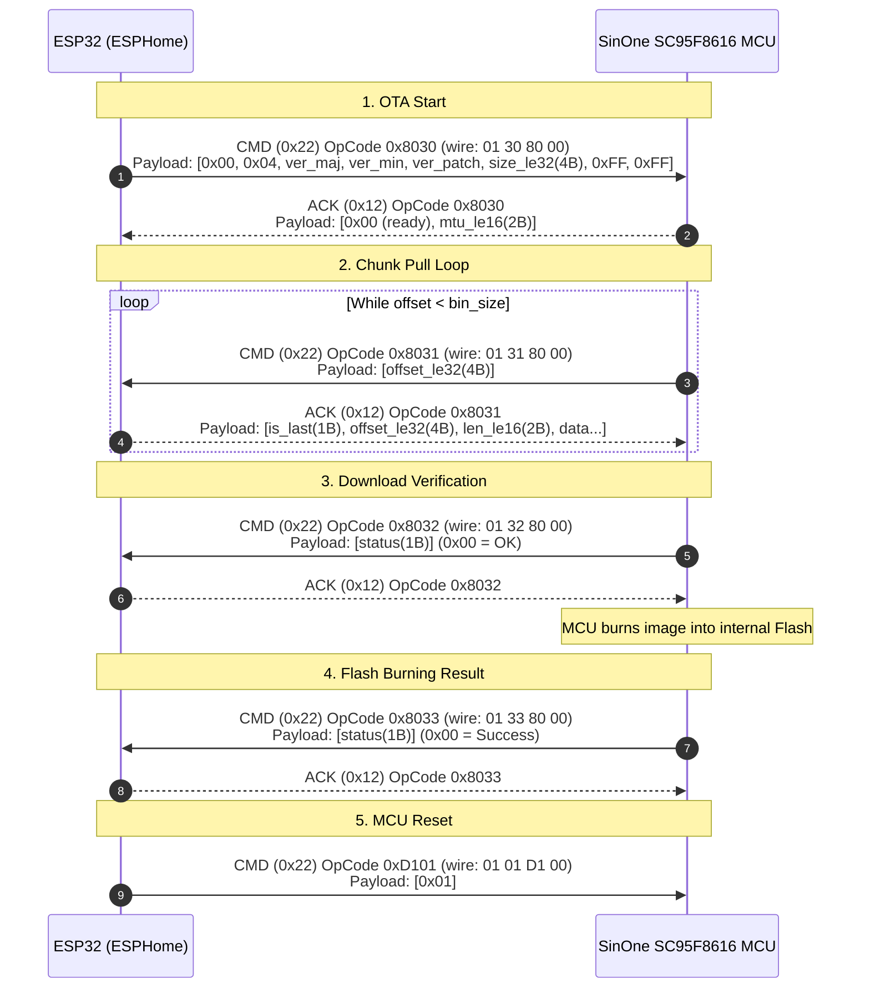

# Levoit Main Controller MCU (SinOne SC95F8616) UART DFU Protocol Specification

This document details the exact In-Application Programming (IAP / DFU) protocol used by the **Levoit Core 300S (and related models)** to flash the Main Appliance Controller board over its internal UART interconnect.

---

## 1. Hardware Architecture & Bus Topology

* **Host Processor:** Espressif ESP32-SOLO-1C (160 MHz Xtensa LX6, 4 MB Flash) running ESPHome.
* **Target MCU:** SinOne SC95F8616 (high-speed 1T 8051-core MCU, 16 KB Flash ROM).
* **UART Bus Parameters:**
  * Baud Rate: `115200`
  * Data bits: 8, Stop bits: 1, Parity: None
  * Pins on ESP32: `GPIO17` (TX) $\rightarrow$ MCU RX, `GPIO16` (RX) $\leftarrow$ MCU TX

---

## 2. Wire Framing & Transport Encoding

Every frame begins with sync byte `0xA5`:
```
+------+----------+-----+--------+--------+----------+-----------------------------+
| 0xA5 | msg_type | seq | len_lo | len_hi | checksum | payload (inner payload)     |
+------+----------+-----+--------+--------+----------+-----------------------------+
   0        1        2      3        4         5       6 ... (6 + len)
```
- `msg_type`: `0x22` (CMD / Request), `0x12` (ACK / Response).
- `seq`: 8-bit rolling counter.
- `len`: 16-bit payload length (LE16).
- `checksum`: `0xFF ^ (sum(frame[0..4] + payload) & 0xFF)`.

### Inner OpCode Encapsulation
The first 4 bytes of the payload encapsulate the 16-bit opcode `0xXXYY`:
```
payload[0] = 0x01
payload[1] = 0xYY (opcode low byte)
payload[2] = 0xXX (opcode high byte)
payload[3] = 0x00 (sub-channel / reserved)
payload[4..] = arguments
```

---

## 3. Detailed DFU Sequence & Packet Formats



### Packet 1: Start OTA (`0x8030` / wire `01 30 80 00`)
* **ESP32 $\rightarrow$ MCU:**
  * `payload[0]`: `0x00` (channel)
  * `payload[1]`: `0x04` (version string length)
  * `payload[2..4]`: Target Version (`major`, `minor`, `patch`)
  * `payload[5..8]`: Binary size in bytes (LE32)
  * `payload[9..10]`: `0xFF, 0xFF` (flags)
* **MCU $\rightarrow$ ESP32 ACK:**
  * `payload[0]`: Status (`0x00` = ready to accept update)
  * `payload[1..2]`: Preferred chunk MTU (LE16, e.g. `0x0200` = 512 or `0x0400` = 1024 bytes)

### Packet 2: Request Chunk (`0x8031` / wire `01 31 80 00`)
* **MCU $\rightarrow$ ESP32:**
  * `payload[0..3]`: Requested offset in binary (LE32)
* **ESP32 $\rightarrow$ MCU ACK:**
  * `payload[0]`: `0x00` (normal chunk) or `0x01` (last chunk)
  * `payload[1..4]`: Offset (LE32)
  * `payload[5..6]`: Chunk length (LE16)
  * `payload[7..]`: Raw binary slice

### Packet 3: Download Complete & Integrity Verification (`0x8032` / wire `01 32 80 00`)
* **MCU $\rightarrow$ ESP32:**
  * `payload[0]`: Status (`0x00` = verified OK)
* **ESP32 $\rightarrow$ MCU ACK:** Empty payload.

### Packet 4: Flash Programming Result (`0x8033` / wire `01 33 80 00`)
* **MCU $\rightarrow$ ESP32:**
  * `payload[0]`: Status (`0x00` = flashed successfully)
* **ESP32 $\rightarrow$ MCU ACK:** Empty payload.

### Packet 5: Reboot MCU (`0xD101` / wire `01 01 D1 00`)
* **ESP32 $\rightarrow$ MCU:**
  * `payload[0]`: `0x01` (trigger software restart)
