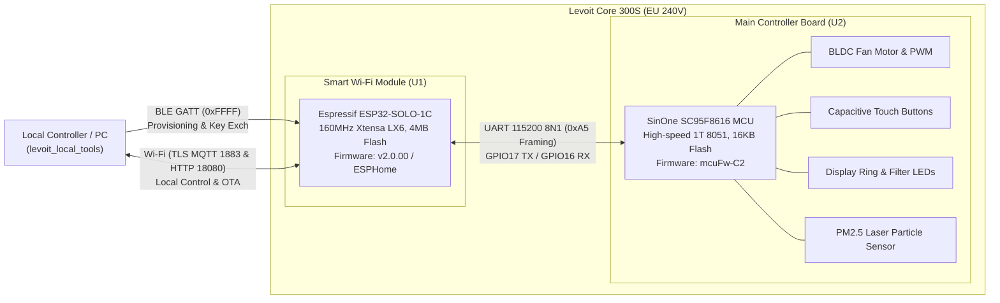
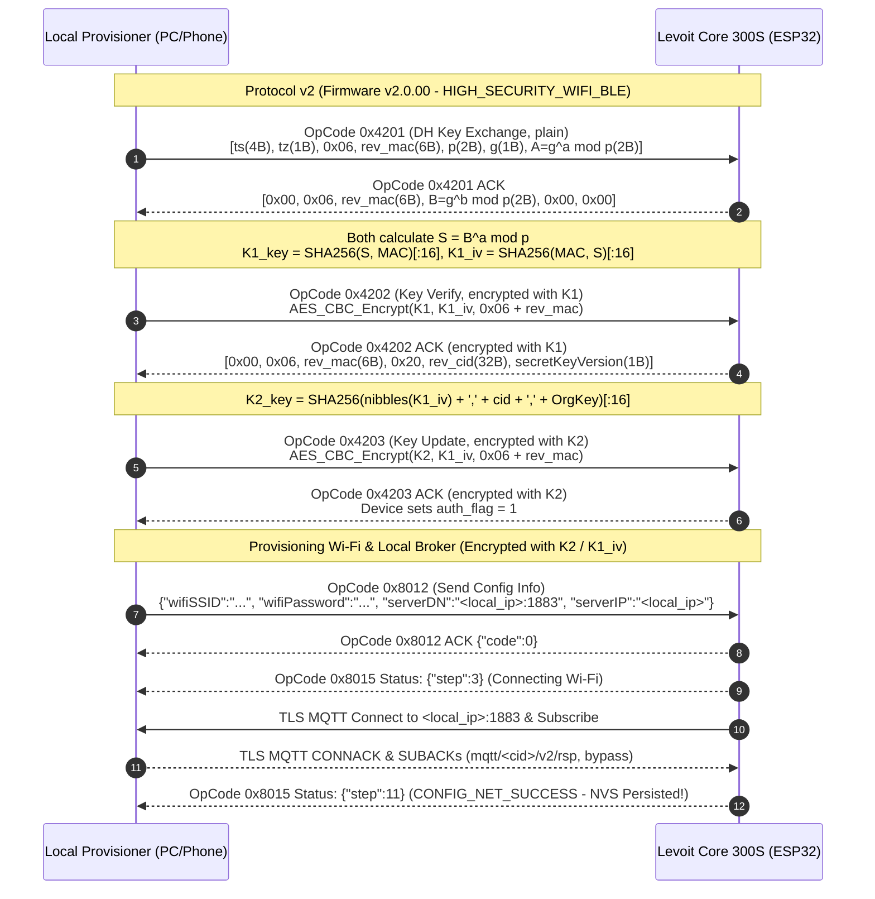
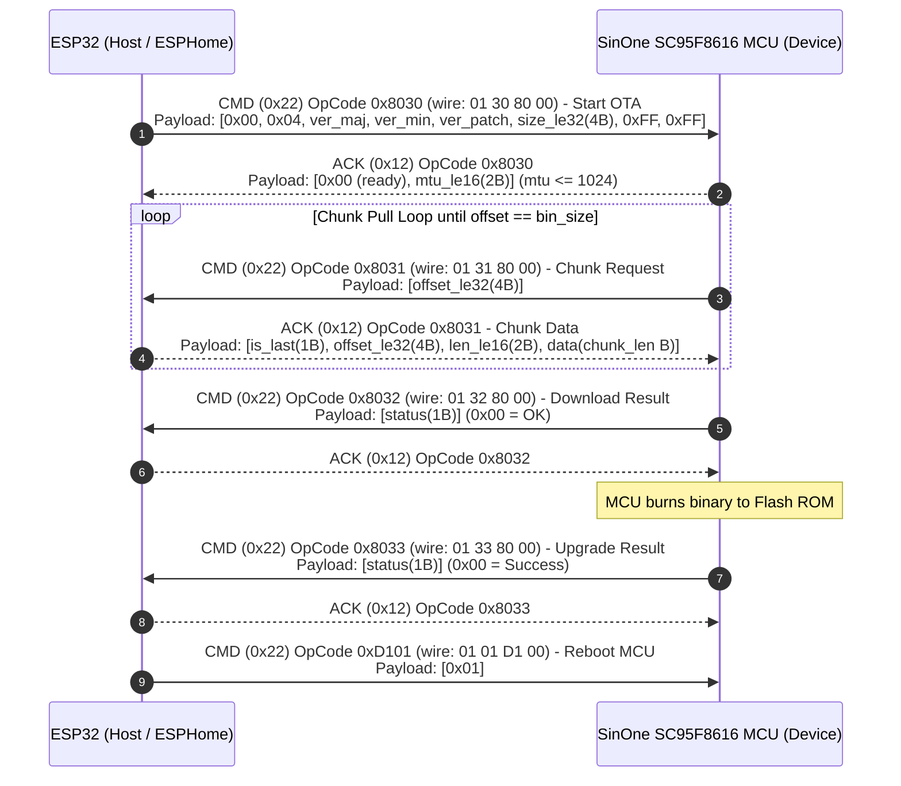

# Levoit Core 300S Smart Air Purifier: Comprehensive Firmware Analysis, Dual-Controller DFU & Cloud-Free Onboarding Guide

> [!NOTE]
> This document details the complete reverse-engineering of the **Levoit Core 300S Smart Air Purifier** (shipped from Amazon EU, 240V model `WiFiBTOnboardingNotify_AirPurifier_Core300S_EU`), extracted from the **VeSync** Android app (`com.etekcity.vesyncplatform`) and official firmware images ([`Core300s_EU_ota_v2.0.00.rel.bin`](file:///Users/arcsur/REA/levoit_firmware/Core300s_EU_ota_v2.0.00.rel.bin) and [`Core300s_EU_ota_v1.1.08.rel.bin`](file:///Users/arcsur/REA/levoit_firmware/Core300s_EU_ota_v1.1.08.rel.bin)).
> 
> All reverse-engineered routines have been verified against Xtensa LX6 assembly and Ghidra decompilation in [`decompiled_core300s_v2_annotated.c`](file:///Users/arcsur/REA/levoit_firmware/decompiled_core300s_v2_annotated.c). Standalone, cloud-free local tools are provided in [`/Users/arcsur/REA/levoit_local_tools/`](file:///Users/arcsur/REA/levoit_local_tools/).

---

## 1. Executive Summary & Goals Achieved

1. **100% Cloud-Free Wi-Fi Pairing:**
   - **Root Cause of the Cloud Dependency:** When Wi-Fi credentials are sent over BLE (OpCode `0x8012`), the device connects to the Wi-Fi AP but does **not** persist credentials to NVS flash immediately. It attempts a TLS MQTT connection to `serverDN` / `serverIP` and subscribes to two topics: `mqtt/<cid>/v2/rsp` and `mqtt/<cid>/v2/bypass`. Only when both MQTT `SUBACK` confirmations arrive does [`netcfg_ev_cb_nwk_connected`](file:///Users/arcsur/REA/levoit_firmware/decompiled_core300s_v2_annotated.c#L28792-L28830) (`0x400e96dc`) execute `FUN_400df6bc` to write the SSID and password to NVS flash (`net_info`) and send `CONFIG_NET_SUCCESS` (`step = 11`) over BLE. If this handshake fails within 60 seconds, credentials are wiped.
   - **Cloud-Free Solution:** By pointing `serverDN` / `serverIP` in the BLE `0x8012` payload to a local machine running [`levoit_local_cloud.py`](file:///Users/arcsur/REA/levoit_local_tools/levoit_local_cloud.py), the local TLS MQTT responder immediately grants `CONNACK` and both `SUBACK`s, causing the device to persist Wi-Fi credentials to NVS flash without ever connecting to the internet or a VeSync account.
2. **Dual-Controller Architecture & Main MCU DFU:**
   - **Smart / Connectivity Controller:** Espressif **ESP32-SOLO-1C** (single-core Xtensa LX6, 4MB Flash).
   - **Main Appliance Controller (U2 MCU):** SinOne **SC95F8616** (8051-core MCU) controlling the BLDC motor, touch buttons, capacitive wheel, status LEDs, and PM2.5 laser particle sensor.
   - **Inter-Chip Interconnect:** UART at **115200 baud, 8N1** (`GPIO17` ESP32 TX $\rightarrow$ MCU RX, `GPIO16` ESP32 RX $\leftarrow$ MCU TX) using standard `0xA5` VeSync framing.
   - **MCU Firmware Updates:** The Main Controller MCU can be upgraded locally over UART without opening the appliance casing. The exact DFU state machine ([`vesync_ota_mcu_start`](file:///Users/arcsur/REA/levoit_firmware/decompiled_core300s_v2_annotated.c#L26965-L27046) `@ 0x400e7dbc` and [`ota_mcu_bin_requst`](file:///Users/arcsur/REA/levoit_firmware/decompiled_core300s_v2_annotated.c#L26798-L26930) `@ 0x400e7b9c`) has been fully reverse-engineered and implemented in C++ ([`esphome_mcu_ota.h`](file:///Users/arcsur/REA/levoit_local_tools/esphome_mcu_ota.h)) for [`acvigue/esphome-levoit-air-purifier`](file:///Users/arcsur/REA/esphome-levoit-air-purifier/components/levoit/levoit.h).
3. **Over-The-Air Flashing of ESPHome:**
   - The stock firmware allows wireless OTA updates via the local MQTT command `bypassV2` $\rightarrow$ `upFirmware`.
   - By prepending the 128-byte VeSync `.rel.bin` header (with MD5 checksum and version string `2.0.00`) using [`levoit_local_cloud.py --wrap-esphome`](file:///Users/arcsur/REA/levoit_local_tools/levoit_local_cloud.py), an unsigned ESPHome binary is accepted and flashed by the stock bootloader over Wi-Fi without hardware disassembly.

---

## 2. Dual-Controller Hardware Architecture



### Static Device Constants (from `v2.0.00` DRAM Segment `0x3ffbdb60`)
- **Firmware Version (`fw_ver`):** `'2.0.00'` (`0x3ffbdca5`)
- **Hardware Version (`hw_ver`):** `'1.0'` (`0x3ffbdc9c`)
- **Model Name (`model`):** `'Core300s'` (`0x3ffbdc69`)
- **Product ID (`pid`):** `'f1uguw34h4859tib'` (`0x400d10ec`)
- **Region Code (`region`):** `'EU'` (`0x3ffbdc54`)
- **Config Model (`cfg_model`):** `'WiFiBTOnboardingNotify_AirPurifier_Core300S_EU'` (`0x3ffbdc26`)
- **MQTT Username Prefix:** `'ww6zvzwtaa6hqjl991g0w1obkeo0sd44'` (`0x3ffbdc04`)
- **Default MQTT Username:** `<prefix><pid><region>` $\rightarrow$ `'ww6zvzwtaa6hqjl991g0w1obkeo0sd44f1uguw34h4859tibEU'`

---

## 3. BLE Onboarding & Key Negotiation Protocol

The Core 300S advertises BLE service `0000ffff-0000-1000-8000-00805f9b34fb` with Manufacturer Data containing company identifier `0x06D0` (1744).

### BLE Manufacturer Data Format (`FUN_400e65e8` @ `0x400e65e8`)
| Offset | Length | Description | Core 300S Value |
|---|---|---|---|
| `0..1` | 2 | Company ID (LE16) | `0xD0, 0x06` (`0x06D0`) |
| `2..8` | 7 | Device Type / Sub-ID | Device specific |
| `9..10` | 2 | Model Code (LE16) | `0xC6, 0x2E` (50734) |
| `11` | 1 | Hardware Version | `0x01` |
| `12` | 1 | Protocol Version | `0x01` (`v1.1.08`) or `0x02` (`v2.0.00`) |
| `13` | 1 | Netcfg Status | `0x01` = Pairing Mode Active |

### Frame Transport Layer (`FUN_400e1134` @ `0x400e1134`)
All BLE and UART frames share a 6-byte outer header:
```
[0x00]      0xA5 (Frame Sync Header)
[0x01]      msg_type: 0x22 (SEND_CMD) or 0x12 (ACK_RSP)
[0x02]      seq: 8-bit rolling sequence number
[0x03..0x04] len: 16-bit payload length (LE16)
[0x05]      checksum: 0xFF ^ (sum(header[0..4] + payload) & 0xFF)
[0x06..]    inner payload
```

### Protocol v1 vs Protocol v2 Handshake Sequence



### Derivation of Session Key `K2` (`vesync_netcfg_gen_session_key` @ `0x400e89e8`)
When `secretKeyVersion == 0`, `OrgKey` is reconstructed in [`FUN_400e8800`](file:///Users/arcsur/REA/levoit_firmware/decompiled_core300s_v2_annotated.c#L27802-L27820) as:
```
OrgKey = "msZW1oKXw5LcyDCi8fFjXvp38HStfuqY"
```
The exact byte buffer passed to `SHA256` has length 98:
- `buf[0..31]`: 32 bytes expanding the 16 bytes of `K1_iv` into high and low nibbles (`buf[2*i] = K1_iv[i] >> 4`, `buf[2*i+1] = K1_iv[i] & 0x0F`).
- `buf[32]`: ASCII `','` (`0x2C`).
- `buf[33..64]`: 32 ASCII bytes of the device `cid`.
- `buf[65]`: ASCII `','` (`0x2C`).
- `buf[66..97]`: 32 ASCII bytes of `OrgKey`.

`K2_key` is the first 16 bytes of `SHA256(buf)`.

---

## 4. Main Controller (SC95F8616 MCU) UART DFU Protocol

When updating the appliance controller over UART, the ESP32 acts as the DFU host and the SinOne SC95F8616 acts as the DFU device over `115200` 8N1 UART.



### Relevant Code Addresses in Firmware `v2.0.00`
- [`vesync_ota_mcu_start`](file:///Users/arcsur/REA/levoit_firmware/decompiled_core300s_v2_annotated.c#L26965-L27046) (`0x400e7dbc`): Formats 11-byte start payload and awaits semaphore.
- [`ota_mcu_bin_requst`](file:///Users/arcsur/REA/levoit_firmware/decompiled_core300s_v2_annotated.c#L26798-L26930) (`0x400e7b9c`): Reads requested offset, bounds-checks against `bin_size`, and formats chunk ACK with `[is_last, offset, len, data]`.
- [`purifier_uart_reboot_mcu`](file:///Users/arcsur/REA/levoit_firmware/decompiled_core300s_v2_annotated.c#L6604-L6620) (`0x400d9528`): Sends `01 01 D1 00` with payload `{0x01}` to reboot the SC95F8616.

---

## 5. VeSync OTA Container (`.rel.bin`) & ESPHome Flashing

The ESP32 firmware binary downloaded during OTA (`pluginName = "mainFw"`) contains a 128-byte header validated by [`main_dev_fw_dl_cb`](file:///Users/arcsur/REA/levoit_firmware/decompiled_core300s_v2_annotated.c#L10982-L11260) (`0x400dc864`):

```
+-------------------------------------------------------------------+
| 0x00..0x1F (32 bytes): ASCII MD5 hex digest of payload (offset 0x80+) |
+-------------------------------------------------------------------+
| 0x20..0x23 (4 bytes) : LE32 Header Size = 0x00000080 (128)        |
+-------------------------------------------------------------------+
| 0x24..0x33 (16 bytes): Bootloader version string (e.g. "1.0\0")   |
+-------------------------------------------------------------------+
| 0x34..0x43 (16 bytes): Software version string (e.g. "2.0.00\0")  |
+-------------------------------------------------------------------+
| 0x44..0x53 (16 bytes): Hardware version string (e.g. "1.0\0")     |
+-------------------------------------------------------------------+
| 0x54..0x63 (16 bytes): Model name string (e.g. "Core300s\0")      |
+-------------------------------------------------------------------+
| 0x64..0x7F (28 bytes): Region string (e.g. "EU\0")                |
+-------------------------------------------------------------------+
| 0x80..EOF            : ESP32 App Image (starts with 0xE9)         |
+-------------------------------------------------------------------+
```

> [!IMPORTANT]
> **Downgrade Check:** In [`vesync_ota_wifi_upgrade`](file:///Users/arcsur/REA/levoit_firmware/decompiled_core300s_v2_annotated.c#L11704-L11925) (`0x400dd24c`), the device rejects updates if `newVersion[0] < currentVersion[0]`. Because the stock EU firmware is `2.0.00`, any wrapped ESPHome binary must specify `newVersion = "2.0.00"` or higher, and the string at offset `0x34` of the header must match `newVersion` exactly.

---

## 6. Practical Step-by-Step Instructions

### Step 1: Start the Local TLS MQTT & OTA Server
Run [`levoit_local_cloud.py`](file:///Users/arcsur/REA/levoit_local_tools/levoit_local_cloud.py) on your computer (LAN IP e.g. `192.168.1.50`):

```bash
# Terminal 1: Run local TLS MQTT responder
python3 /Users/arcsur/REA/levoit_local_tools/levoit_local_cloud.py \
    --server-ip 192.168.1.50 \
    --mqtt-port 1883
```

### Step 2: Put Core 300S into Pairing Mode & Provision Wi-Fi
Press and hold the Power button on the Core 300S for **5 seconds** until the Wi-Fi indicator LED begins to flash. Then run [`levoit_ble_provision.py`](file:///Users/arcsur/REA/levoit_local_tools/levoit_ble_provision.py):

```bash
# Terminal 2: Pair over BLE and commit Wi-Fi credentials locally
python3 /Users/arcsur/REA/levoit_local_tools/levoit_ble_provision.py \
    --ssid "MyLocalWiFi" \
    --password "MySecretPassphrase" \
    --server-ip 192.168.1.50 \
    --server-port 1883
```

The tool will:
1. Negotiate the session key (`0x4201` $\rightarrow$ `0x4202` $\rightarrow$ `0x4203`).
2. Transmit the Wi-Fi credentials pointing to `192.168.1.50:1883`.
3. The Core 300S connects to `MyLocalWiFi`, reaches Terminal 1 over TLS MQTT, receives the SUBACKs, and commits the credentials to NVS flash (`CONFIG_NET_SUCCESS`).

### Step 3: Flash ESPHome over Local Wi-Fi OTA (No Screwdriver Needed)
1. Compile your ESPHome configuration for the Core 300S using [`acvigue/esphome-levoit-air-purifier`](file:///Users/arcsur/REA/esphome-levoit-air-purifier/components/levoit/levoit.h) to produce `firmware.bin`.
2. Wrap the binary with the VeSync `.rel.bin` container:
   ```bash
   python3 /Users/arcsur/REA/levoit_local_tools/levoit_local_cloud.py \
       --wrap-esphome firmware.bin esphome_wrapped.rel.bin \
       --new-version 2.0.00
   ```
3. Restart `levoit_local_cloud.py` with the OTA argument:
   ```bash
   python3 /Users/arcsur/REA/levoit_local_tools/levoit_local_cloud.py \
       --server-ip 192.168.1.50 \
       --ota-file esphome_wrapped.rel.bin \
       --plugin mainFw \
       --new-version 2.0.00
   ```
4. As soon as the Core 300S connects, the tool issues `bypassV2` $\rightarrow$ `upFirmware`. The purifier downloads the image from `http://192.168.1.50:18080/fw.bin`, verifies the MD5 digest, writes to the OTA partition, and reboots directly into ESPHome.

### Step 4: Updating the Main Controller MCU from ESPHome
When a new MCU firmware binary (e.g. `mcuFw-C2`) is released:
- Include [`esphome_mcu_ota.h`](file:///Users/arcsur/REA/levoit_local_tools/esphome_mcu_ota.h) in your ESPHome build.
- Call `LevoitMcuOta::start_update(mcu_bin, bin_size)`.
- The class executes the `0x8030` start, streams the 512-byte binary chunks on MCU demand (`0x8031`), checks the download and flash results (`0x8032` / `0x8033`), and commands an MCU reset (`0xD101`).
